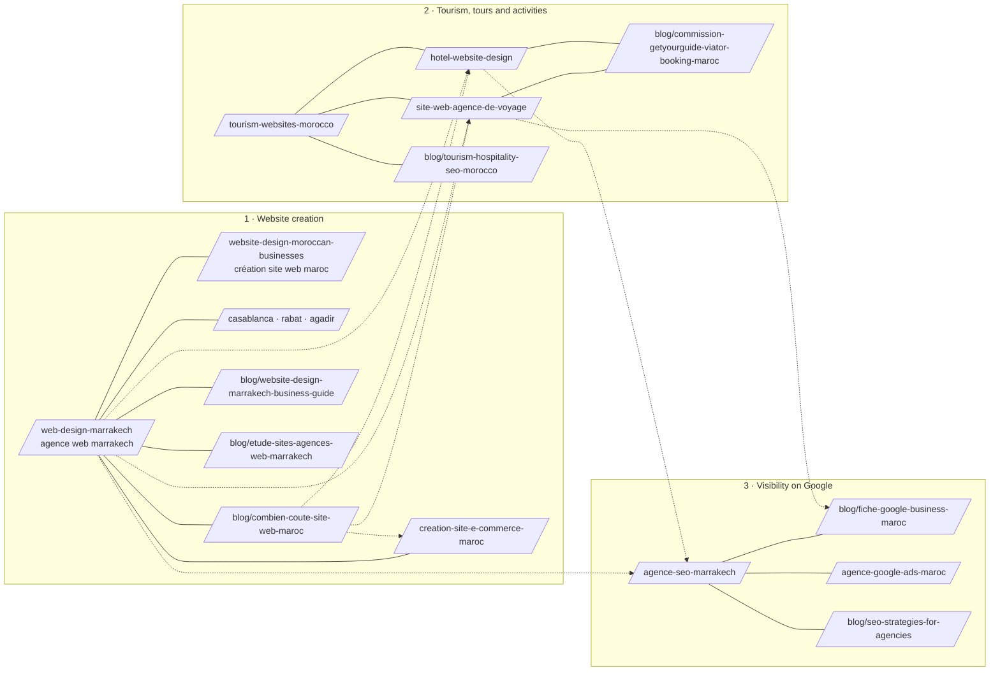

# Topical map — WeReact agency

How the site's pages group into topics, which page leads each topic (the hub), and how they link. Built from the
[keyword research](keyword-research.md) on November 10, 2026. French URLs are shown; each page has an English twin at `/en/…`.

## Pillar 1 — Website creation (Marrakech and Morocco)

| Page | Role | Main query | Status |
|---|---|---|---|
| `/fr/web-design-marrakech` | **Hub** | agence web marrakech · création site web marrakech | Live; absorbed `/agence-web-marrakech` (308) |
| `/fr/website-design-moroccan-businesses` | Spoke | création site web maroc · website design morocco | Live; retargeted to national searches |
| `/fr/web-design-casablanca`, `-rabat`, `-agadir` | Spokes | création site web casablanca / rabat / agadir | Live |
| `/fr/creation-site-e-commerce-maroc` | Spoke (money) | création site e-commerce maroc | **New** |
| `/fr/blog/combien-coute-site-web-maroc` | Spoke (price) | prix site web maroc · combien coûte un site web | Live; links to every offer page |
| `/fr/blog/website-design-marrakech-business-guide` | Spoke (guide) | création site web marrakech (informational) | Live |
| `/fr/blog/etude-sites-agences-web-marrakech` | Spoke (original research) | agence web marrakech (comparison intent) | **New** — study of the agency sites ranking in Marrakech |

## Pillar 2 — Tourism, tours and activities (outreach priority)

| Page | Role | Main query | Status |
|---|---|---|---|
| `/fr/tourism-websites-morocco` | **Hub** | site web tourisme maroc | Live |
| `/fr/site-web-agence-de-voyage` | Spoke (money) | site web agence de voyage · site de réservation excursion | **New** |
| `/fr/hotel-website-design` | Spoke (money), sub-hub for riads | site web riad · création site web riad marrakech | Live |
| `/fr/blog/commission-getyourguide-viator-booking-maroc` | Spoke (information gain) | commission getyourguide · viator commission · commission booking maroc | **New** — sourced commission figures and the direct-booking arithmetic |
| `/fr/blog/tourism-hospitality-seo-morocco` | Spoke (guide) | morocco travel seo · seo tourisme | Live; expanded with the operator checklist |
| Case studies: Flying Tandem, Your Morocco, Kasbah Angour, Trust Drivers, Morocco Atlas Guide | Proof | — | Live |

## Pillar 3 — Visibility on Google

| Page | Role | Main query | Status |
|---|---|---|---|
| `/fr/agence-seo-marrakech` | **Hub** | agence seo marrakech · seo maroc | Live |
| `/fr/blog/fiche-google-business-maroc` | Spoke (guide) | fiche google my business · google maps | **New** |
| `/fr/agence-google-ads-maroc` | Spoke (money) | agence google ads maroc | Live |
| `/fr/agence-marketing-digital-marrakech` | Spoke (money) | agence marketing digital marrakech · agence digitale maroc | **New** Nov 12, 2026 — the four channels together, with sector click prices from Keyword Planner |
| `/fr/seo-landing-pages` | — | landing page maroc | Merged into the Google Ads page on Nov 12, 2026 (never indexed by Google) |
| `/fr/blog/seo-strategies-for-agencies` | Spoke (guide) | — | Live but thin; rewrite or merge later |

## Pillar 4 — The company (entity and trust)

`/fr/about`, `/fr/work` and the case studies, `/fr/book`, `/fr/contact`, and two new pages for machines and people who want
everything in one place: `/fr/sitemap` (HTML sitemap) and `/fr/ai-info` (fact sheet for AI assistants), plus `/llms.txt`.
The entity graph behind them is documented in [`entity-map.html`](entity-map.html).

## Pillar 5 — Starting and running a small business online in Morocco (traffic engine)

Added on November 12, 2026, when the target became **1,000 organic visits a day**. The commercial queries of pillars 1–3 add up
to roughly 7,000 searches a month in Morocco: even first place on all of them is about 50 visits a day. The volume is in the
questions people ask while they set up a business, the moment they also need a website, a Google listing and WhatsApp.
Source: Google Ads Keyword Planner, Morocco, [`data/volumes-adjacent-2026-11-12.csv`](data/volumes-adjacent-2026-11-12.csv).

| Page | Type | Main queries (searches/month, Morocco) | Status |
|---|---|---|---|
| `/fr/agence-marketing-digital-marrakech` | Money page (pillar 3) | agence marketing marrakech 260 · agence marketing digital marrakech 210 · agence digitale maroc 320 · agence digitale marrakech 140 | **Live Nov 12** — honest scope: no social media management |
| `/fr/outils/generateur-lien-whatsapp` | Free tool | lien whatsapp 480 · wa me 260 · lien whatsapp numéro 70 | **Live Nov 12** — wa.me link, pre-filled message, QR code, button code |
| `/fr/blog/auto-entrepreneur-maroc` | Guide (hub of this pillar) | auto entrepreneur maroc 12,100 · statut 480 · carte 390 · facture 390 · déclaration 140 | **Live Nov 12** — from the DGI 2026 guide, law 114-13 and CGI 2026, with the official CNSS scale and cost examples |
| Arabic version of the auto-entrepreneur guide | Guide | المقاول الذاتي 18,100 · مقاول ذاتي 14,800 · بطاقة المقاول الذاتي 1,900 | Needs an Arabic route (decision pending) |
| Invoice generator for auto-entrepreneurs | Free tool | facture auto entrepreneur maroc 390 · facture maroc 390 · modèle facture maroc 170 · facture proforma 1,000 | Next — after the guide fixes the mandatory mentions |
| TVA calculator (20/14/10/7 %) | Free tool | calcul tva 1,000 · tva maroc 1,000 · calcul tva maroc 480 · الضريبة على القيمة المضافة 880 | Planned |
| ICE, certificat négatif, registre de commerce guides | Guides | ice maroc 27,100 · السجل التجاري 8,100 · certificat négatif 6,600 · registre de commerce maroc 1,900 | Planned; mostly portal look-ups, so only the "how to" share is winnable |
| Domain name and hosting in Morocco | Guide | nom de domaine maroc 1,000 · domaine maroc 720 · hébergement web maroc 320 | Planned |
| E-commerce in Morocco: YouCan, Shopify, WooCommerce, payment (CMI) | Guide | e commerce maroc 480 · shopify maroc 260 · dropshipping maroc 210 · cmi paiement en ligne 140 | Planned; links to the e-commerce money page |

Every page in this pillar links to the matching money page (website, e-commerce, Google listing, SEO) in its first screen and
ends with the same offer. Navigational searches (ae.gov.ma login, damancom, simpl, youcan, whatsapp business download) are not
targets: the searcher wants the portal or the app.

### What 1,000 a day takes

Estimated visits a month **if** each page reaches the top three for its main queries (15–25 % of searches become visits; overlaps
removed). These are scenarios, not forecasts.

| Lane | Searches/month | Visits/month at top 3 |
|---|---|---|
| Commercial pages (pillars 1–3, incl. digital marketing) | ~10,000 | ~1,700 |
| Auto-entrepreneur, French | ~13,500 | ~2,000 |
| Auto-entrepreneur, Arabic | ~40,000 | ~6,000 |
| Business admin (ICE, RC, certificat négatif, TVA, invoices) | ~45,000, mostly portal look-ups | ~4,000 |
| Google listing, domains, hosting, e-commerce, WhatsApp | ~12,000 | ~1,500 |
| **Total** | | **~15,000 (≈ 500 a day)** |

So 1,000 a day needs more than Morocco-French pages ranking well: the Arabic versions, every tool, a steady rhythm of new pages
(two to three a week) and links from Moroccan sites and directories. Milestones to check against (targets, not
forecasts): 30 a day by February 2027, 150 a day by mid-2027, 500 a day by the end of 2027, 1,000 a day as the stretch target. Clients still come from the
commercial lane; the rest feeds it through internal links and the offer at the end of each page.

## Internal link rules

1. **Every spoke links to its hub early,** in the lead or first paragraph, with the hub's main query as natural anchor text.
2. **Every hub links to all of its spokes**, in the copy where the reader's question leads there, and in the "Explore next" block.
3. **Cross-pillar links only where the reader's next question goes**: an operator reading about bookings next needs the
   Google Business guide; a price reader next needs the e-commerce, hotel or travel agency page.
4. **Descriptive anchors, varied between pages,** never "click here", and never the same exact anchor from every page.
5. **No links to redirected or missing URLs.** In landing copy, the test `src/lib/inline-links.test.ts` fails the build if a link
   points at a page that does not exist, at the other language, or at the page itself. Across the whole site,
   `node scripts/seo/link-audit.mjs <base-url>` reports orphans, redirects and broken links (latest run: [`link-audit.md`](link-audit.md)).
6. **A new article gets at least three contextual links from older pages on the day it is published.**

Landing copy uses `[anchor text](/fr/page)` inside `src/data/services.ts` and `src/data/audiences.ts`; articles use normal
`<a href>` inside `src/data/blog.ts`.

## Phases

**Done on November 10, 2026:** the Marrakech pages merged; the national page retargeted; the travel agency and e-commerce pages
and the Google Business guide published; links woven through the landing pages and the four older articles; HTML sitemap, AI info
page, generated llms.txt and entity graph added; the commission article and the agency study added (see the commit log for
anything that slipped).

**Done the same day, ranked by search demand** (Keyword Planner, Morocco)
- Casablanca page rewritten with its own content ("agence web casablanca" 880/month, "création site web casablanca" 210);
  text shared with the Rabat page went from 62% to 43%, most of the rest being common blocks (prices, booking, contact).
- National page `/fr/website-design-moroccan-businesses` ("création site web maroc" 1,000/month) deepened: project steps, what
  a showcase site includes, cities served, and the price block.
- New Tangier page `/fr/web-design-tanger` ("création site web tanger" 260/month, "agence seo tanger" 170, "agence web tanger" 70),
  covering website and SEO, languages for a northern clientele, and tourism in the North.

**Next**
- Request indexing in Search Console for every new or changed URL; follow positions of the A keywords every two weeks.
- Rabat page: done Nov 12 (own sections, sector search data from Keyword Planner, honest "not a communication agency" answer).
- Rewrite or merge `seo-strategies-for-agencies`, which is thin and generic.
- Add real proof as it comes: client reviews on the Google profile, and a first project outside Marrakech for the city pages.

**Not worth doing on search demand alone**
- An Arabic version (Arabic website-creation phrases are around 20 searches a month).
- A redesign page ("refonte site web" ~10 a month).
- Pages for specific activity niches: tour operators and riad owners barely search for websites. Reach them through outreach
  with the travel agency, hotel and commission pages as sales material.
- A Google Ads cost guide based on WeReact's own campaign data stays an option, only if the owner agrees to publish the numbers.
