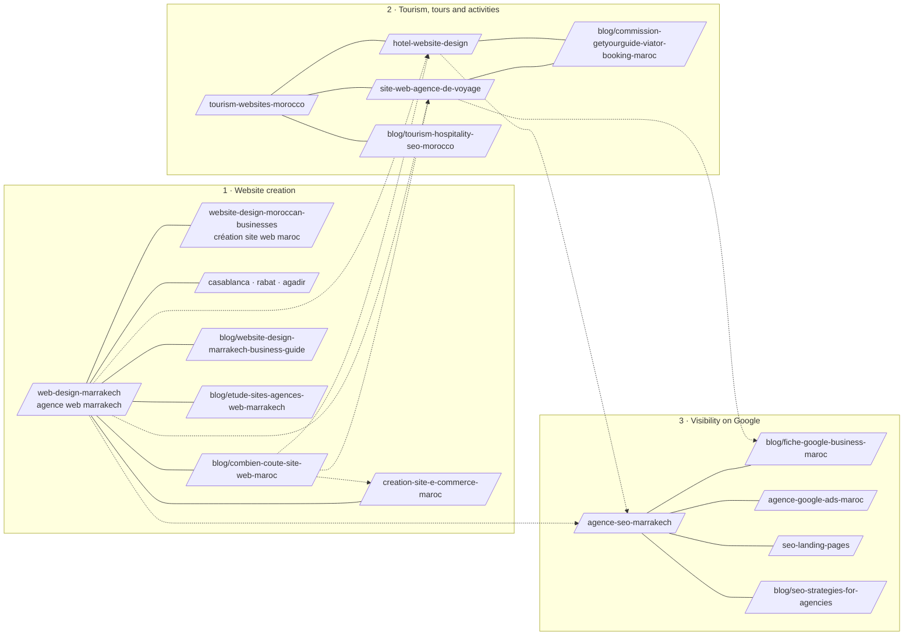

# Topical map — WeReact agency

How the site's pages group into topics, which page leads each topic (the hub), and how they link. Built from the
[keyword research](keyword-research.md) on November 10, 2026. French URLs are shown; each page has an English twin at `/en/…`.

## Pillar 1 — Website creation (Marrakech and Morocco)

| Page | Role | Main query | Status |
|---|---|---|---|
| `/fr/web-design-marrakech` | **Hub** | agence web marrakech · création site web marrakech | Live; absorbed `/agence-web-marrakech` (308) |
| `/fr/website-design-moroccan-businesses` | Spoke | création site web maroc · website design morocco | Live; retargeted to national searches |
| `/fr/web-design-casablanca`, `-rabat`, `-agadir` | Spokes | création site web casablanca / rabat / agadir | Live |
| `/fr/creation-site-e-commerce-maroc` | Spoke (money) | création site e-commerce maroc | **New** |
| `/fr/blog/combien-coute-site-web-maroc` | Spoke (price) | prix site web maroc · combien coûte un site web | Live; links to every offer page |
| `/fr/blog/website-design-marrakech-business-guide` | Spoke (guide) | création site web marrakech (informational) | Live |
| `/fr/blog/etude-sites-agences-web-marrakech` | Spoke (original research) | agence web marrakech (comparison intent) | **New** — study of the agency sites ranking in Marrakech |

## Pillar 2 — Tourism, tours and activities (outreach priority)

| Page | Role | Main query | Status |
|---|---|---|---|
| `/fr/tourism-websites-morocco` | **Hub** | site web tourisme maroc | Live |
| `/fr/site-web-agence-de-voyage` | Spoke (money) | site web agence de voyage · site de réservation excursion | **New** |
| `/fr/hotel-website-design` | Spoke (money), sub-hub for riads | site web riad · création site web riad marrakech | Live |
| `/fr/blog/commission-getyourguide-viator-booking-maroc` | Spoke (information gain) | commission getyourguide · viator commission · commission booking maroc | **New** — sourced commission figures and the direct-booking arithmetic |
| `/fr/blog/tourism-hospitality-seo-morocco` | Spoke (guide) | morocco travel seo · seo tourisme | Live; expanded with the operator checklist |
| Case studies: Flying Tandem, Your Morocco, Kasbah Angour, Trust Drivers, Morocco Atlas Guide | Proof | — | Live |

## Pillar 3 — Visibility on Google

| Page | Role | Main query | Status |
|---|---|---|---|
| `/fr/agence-seo-marrakech` | **Hub** | agence seo marrakech · seo maroc | Live |
| `/fr/blog/fiche-google-business-maroc` | Spoke (guide) | fiche google my business · google maps | **New** |
| `/fr/agence-google-ads-maroc` | Spoke (money) | agence google ads maroc | Live |
| `/fr/seo-landing-pages` | Spoke (money) | landing page maroc | Live |
| `/fr/blog/seo-strategies-for-agencies` | Spoke (guide) | — | Live but thin; rewrite or merge later |

## Pillar 4 — The company (entity and trust)

`/fr/about`, `/fr/work` and the case studies, `/fr/book`, `/fr/contact`, and two new pages for machines and people who want
everything in one place: `/fr/sitemap` (HTML sitemap) and `/fr/ai-info` (fact sheet for AI assistants), plus `/llms.txt`.
The entity graph behind them is documented in [`entity-map.html`](entity-map.html).

## Internal link rules

1. **Every spoke links to its hub early,** in the lead or first paragraph, with the hub's main query as natural anchor text.
2. **Every hub links to all of its spokes**, in the copy where the reader's question leads there, and in the "Explore next" block.
3. **Cross-pillar links only where the reader's next question goes**: an operator reading about bookings next needs the
   Google Business guide; a price reader next needs the e-commerce, hotel or travel agency page.
4. **Descriptive anchors, varied between pages,** never "click here", and never the same exact anchor from every page.
5. **No links to redirected or missing URLs.** In landing copy, the test `src/lib/inline-links.test.ts` fails the build if a link
   points at a page that does not exist, at the other language, or at the page itself. Across the whole site,
   `node scripts/seo/link-audit.mjs <base-url>` reports orphans, redirects and broken links (latest run: [`link-audit.md`](link-audit.md)).
6. **A new article gets at least three contextual links from older pages on the day it is published.**

Landing copy uses `[anchor text](/fr/page)` inside `src/data/services.ts` and `src/data/audiences.ts`; articles use normal
`<a href>` inside `src/data/blog.ts`.

## Phases

**Done on November 10, 2026:** the Marrakech pages merged; the national page retargeted; the travel agency and e-commerce pages
and the Google Business guide published; links woven through the landing pages and the four older articles; HTML sitemap, AI info
page, generated llms.txt and entity graph added; the commission article and the agency study added (see the commit log for
anything that slipped).

**Next four weeks**
- Reconnect the Ads Keyword Planner and fill `volume_ma` in the CSV; re-rank priority B rows with real volumes.
- Request indexing in Search Console for every new or changed URL; resubmit the sitemap.
- Follow positions in Search Console for the A keywords of each hub, every two weeks.
- Rewrite `seo-strategies-for-agencies`, which is thin and generic, or merge it into the Google Business guide.

**Later**
- An Arabic version of the website-creation pillar (demand exists in autocomplete; a competitor ranks with an Arabic homepage).
- A redesign page ("refonte site web") if Keyword Planner shows enough Moroccan volume.
- A Google Ads cost guide based on WeReact's own campaign data, only if the owner agrees to publish those numbers.
- Pages for specific activity niches (balloon, quad, desert camps) only once there is a real client or case study in that niche.
